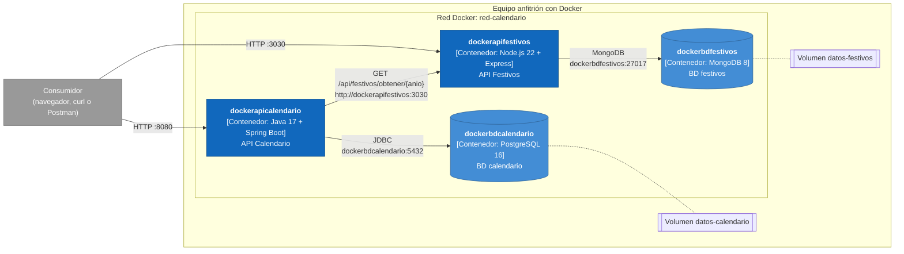

# Quinta entrega - Contenerización con Docker

Despliegue en contenedores Docker del sistema formado por la **API Festivos** (Express JS +
MongoDB) y la **API Calendario** (Spring Boot + PostgreSQL). Cada API corre en su propio
contenedor junto a su propia base de datos, y la API Calendario es cliente de la API
Festivos. Los cuatro contenedores se orquestan con un solo archivo
[docker-compose.yml](docker-compose.yml) y se comunican por una red común, llamándose por el
nombre del contenedor en lugar de `localhost`.

**Esta carpeta es autocontenida.** Trae el código completo de las dos APIs, sus Dockerfiles,
los scripts de las bases de datos y el `docker-compose.yml`. No depende de ninguna otra
carpeta del repositorio:

| Carpeta | Contenido |
|---|---|
| [api-festivos/](api-festivos/) | Código de la API Festivos ([README](api-festivos/README.md)), su [Dockerfile](api-festivos/Dockerfile) y, en [bd/](api-festivos/bd/), el script de datos y el Dockerfile de MongoDB |
| [api-calendario/](api-calendario/) | Código de la API Calendario ([README](api-calendario/README.md)), su [Dockerfile](api-calendario/Dockerfile) y, en [bd/](api-calendario/bd/), los scripts SQL y el Dockerfile de PostgreSQL |
| [docker-compose.yml](docker-compose.yml) | Orquestación de los 4 contenedores, la red y los volúmenes |

## Diagrama de despliegue



Solo las dos APIs publican un puerto en el equipo anfitrión (`3030` y `8080`). Las bases de
datos quedan accesibles únicamente dentro de la red `red-calendario`: así no chocan con un
MongoDB o un PostgreSQL instalados en el equipo, y nadie de fuera de la red llega a ellas.

## Requisitos

| Software | Comprobar con |
|---|---|
| Docker Desktop (Windows y macOS) o Docker Engine con el plugin Compose (Linux) | `docker compose version` |

No hace falta tener instalado Node.js, Java, Maven, MongoDB ni PostgreSQL: todo se descarga
y se compila dentro de las imágenes. Los puertos `3030` y `8080` del equipo deben estar
libres (por ejemplo, sin las APIs de la tercera y cuarta entrega corriendo en local).

## Ejecución

Desde esta carpeta (`quinta-entrega`):

```bash
docker compose up --build
```

La primera vez tarda unos minutos, porque descarga las imágenes base y compila la API
Calendario con Maven. Docker levanta los contenedores en este orden, y cada uno espera a que
el anterior esté sano (`healthcheck`) antes de arrancar:

1. `dockerbdfestivos` y `dockerbdcalendario`. Con el volumen vacío cargan sus scripts de datos.
2. `dockerapifestivos`, cuando MongoDB ya tiene los datos de los festivos.
3. `dockerapicalendario`, cuando PostgreSQL tiene las tablas y la API Festivos ya responde.

El sistema está listo cuando el log muestra `Started ApiApplication`. Para dejarlo corriendo
en segundo plano se usa `docker compose up --build -d`, y `docker compose ps` muestra el
estado de cada contenedor.

### Comprobar

```bash
curl http://localhost:3030/api/festivos/obtener/2026     # festivos de 2026
curl http://localhost:8080/api/calendario/generar/2026   # true
curl http://localhost:8080/api/calendario/listar/2026    # los 365 días de 2026 clasificados
```

`generar` responde `true` solo si la API Calendario consiguió llamar a la API Festivos por la
red de Docker, así que esa respuesta comprueba también la comunicación entre contenedores.

La documentación interactiva de las dos APIs queda en Swagger UI:

| API | Swagger UI |
|---|---|
| API Festivos | `http://localhost:3030/api-docs` |
| API Calendario | `http://localhost:8080/swagger-ui.html` |

Las demás operaciones y sus ejemplos están en el README de cada API:
[API Festivos](api-festivos/README.md#operaciones) y
[API Calendario](api-calendario/README.md#operaciones).

En Windows, `curl` no envía en UTF-8 las tildes escritas en la línea de comandos (`-d
'{"tipo": "Día cívico"}'`): la API Calendario responde 400 por JSON no válido y la API Festivos
guarda el nombre con caracteres dañados. Para esos ejemplos se usa Postman o Swagger UI, o
se guarda el cuerpo en un archivo UTF-8 y se envía con `--data-binary @archivo.json`. En
Linux y macOS los ejemplos funcionan tal cual.

### Detener y limpiar

```bash
docker compose down      # detiene y elimina los contenedores; los datos se conservan
docker compose down -v   # además elimina los volúmenes con los datos
```

Después de `down -v`, el siguiente `docker compose up --build` crea las bases de datos desde
cero y vuelve a cargar los scripts. Con `down` sin `-v` los volúmenes se conservan y los
scripts **no** se vuelven a ejecutar (las imágenes de MongoDB y PostgreSQL solo los corren
cuando el directorio de datos está vacío).

## Contenedores

| Contenedor | Imagen | Construida desde | Puerto en el anfitrión |
|---|---|---|---|
| `dockerbdfestivos` | `dockerbdfestivos` (base `mongo:8.0`) | [api-festivos/bd/Dockerfile](api-festivos/bd/Dockerfile) | ninguno |
| `dockerapifestivos` | `dockerapifestivos` (base `node:22-alpine`) | [api-festivos/Dockerfile](api-festivos/Dockerfile) | `3030` |
| `dockerbdcalendario` | `dockerbdcalendario` (base `postgres:16`) | [api-calendario/bd/Dockerfile](api-calendario/bd/Dockerfile) | ninguno |
| `dockerapicalendario` | `dockerapicalendario` (base `eclipse-temurin:17-jre-alpine`) | [api-calendario/Dockerfile](api-calendario/Dockerfile) | `8080` |

Los nombres siguen la convención del ejemplo de clase (`dockerbdmonedas`, `dockerapimonedas`):
`dockerbd...` para las bases de datos y `dockerapi...` para las APIs. En el
`docker-compose.yml` los servicios se llaman igual sin el prefijo `docker` (`bdfestivos`,
`apifestivos`, `bdcalendario`, `apicalendario`), y dentro de la red cada contenedor se
encuentra por su nombre de contenedor.

### API Festivos

[Dockerfile](api-festivos/Dockerfile) de una etapa: parte de `node:22-alpine`, instala las
dependencias con `npm ci` (versiones exactas del `package-lock.json`) y copia el código. Las
dependencias se copian e instalan antes que el código, para que Docker reutilice esa capa
cuando solo cambia el código.

### API Calendario

[Dockerfile](api-calendario/Dockerfile) de dos etapas (*multi-stage*):

1. **Compilación** (`maven:3.9-eclipse-temurin-17`): copia el proyecto multimódulo y ejecuta
   `mvn clean package -DskipTests`, que genera `presentacion/target/apicalendario.jar`.
2. **Ejecución** (`eclipse-temurin:17-jre-alpine`): copia solo el `.jar` de la etapa anterior.
   La imagen final no lleva Maven, el código fuente ni el compilador, así que es mucho más
   liviana.

### Bases de datos

Cada base de datos tiene su propio Dockerfile, que parte de la imagen oficial y copia los
scripts a `/docker-entrypoint-initdb.d/`. La imagen oficial ejecuta esos scripts al arrancar
por primera vez:

- **MongoDB** ([api-festivos/bd/](api-festivos/bd/)): `01_BDFestivos.js` crea la colección
  `tipos` de la base de datos `festivos` con los 4 tipos y sus 19 festivos.
- **PostgreSQL** ([api-calendario/bd/](api-calendario/bd/)): `01_DDL_Calendario.sql` crea la
  base de datos `calendario` y las tablas `Tipo` y `Calendario`, y `02_DML_Calendario.sql`
  carga el catálogo de tipos. Los scripts se ejecutan en orden alfabético, y el prefijo
  numérico asegura que el DDL corra antes que el DML.

Los datos se guardan en los volúmenes `datos-festivos` y `datos-calendario`, de modo que
sobreviven a `docker compose down` y a reiniciar los contenedores.

## Configuración

Las APIs no cambiaron: siguen leyendo su configuración de variables de entorno, con valores
por defecto para correr en local (`localhost`). En Docker, el `docker-compose.yml` le da a
cada variable el nombre del contenedor correspondiente.

### API Festivos

| Variable | Valor por defecto (local) | Valor en Docker |
|---|---|---|
| `PUERTO` | `3030` | `3030` |
| `BD_SERVIDOR` | `localhost` | `dockerbdfestivos` |
| `BD_PUERTO` | `27017` | `27017` |
| `BD_BASEDATOS` | `festivos` | `festivos` |
| `BD_USUARIO` / `BD_CLAVE` | vacíos (sin autenticación) | vacíos (sin autenticación) |

### API Calendario

| Variable | Valor por defecto (local) | Valor en Docker |
|---|---|---|
| `PUERTO` | `8080` | `8080` |
| `BD_SERVIDOR` | `localhost` | `dockerbdcalendario` |
| `BD_PUERTO` | `5432` | `5432` |
| `BD_BASEDATOS` | `calendario` | `calendario` |
| `BD_USUARIO` / `BD_CLAVE` | `postgres` / `sa` | `postgres` / `sa` |
| `API_FESTIVOS_URL` | `http://localhost:3030` | `http://dockerapifestivos:3030` |

### Bases de datos

| Contenedor | Variable | Valor | Definida en |
|---|---|---|---|
| `dockerbdfestivos` | `MONGO_INITDB_DATABASE` | `festivos` | [api-festivos/bd/Dockerfile](api-festivos/bd/Dockerfile) |
| `dockerbdcalendario` | `POSTGRES_USER` / `POSTGRES_PASSWORD` | `postgres` / `sa` | [docker-compose.yml](docker-compose.yml) |

Dentro de un contenedor, `localhost` es el propio contenedor. Por eso la API Calendario no
puede llamar a `http://localhost:3030`: la API Festivos está en otro contenedor. Lo encuentra
por su nombre, `dockerapifestivos`, gracias al DNS interno de la red `red-calendario`.

## Equivalente con comandos de Docker

El `docker-compose.yml` reemplaza la secuencia de comandos del Taller 4. A mano sería, desde
esta carpeta:

```bash
docker network create red-calendario

docker build -t dockerbdfestivos api-festivos/bd
docker run -d --name dockerbdfestivos --network red-calendario dockerbdfestivos

docker build -t dockerapifestivos api-festivos
docker run -d --name dockerapifestivos --network red-calendario -p 3030:3030 \
  -e BD_SERVIDOR=dockerbdfestivos dockerapifestivos

docker build -t dockerbdcalendario api-calendario/bd
docker run -d --name dockerbdcalendario --network red-calendario \
  -e POSTGRES_PASSWORD=sa dockerbdcalendario

docker build -t dockerapicalendario api-calendario
docker run -d --name dockerapicalendario --network red-calendario -p 8080:8080 \
  -e BD_SERVIDOR=dockerbdcalendario -e API_FESTIVOS_URL=http://dockerapifestivos:3030 \
  dockerapicalendario
```

Con comandos sueltos hay que esperar a mano a que cada base de datos termine de cargar antes
de arrancar su API. Compose lo resuelve con los `healthcheck` y `depends_on`.

## Ejecución sin Docker

Las APIs se siguen pudiendo ejecutar en local sin cambiar nada, como en la tercera y cuarta
entrega: los pasos están en el README de la [API Calendario](api-calendario/README.md#ejecución),
que levanta los cuatro servicios en orden.

## Decisiones para revisar

Puntos que el enunciado no fija y en los que se tomó la opción más simple:

- **Script de MongoDB.** El script de la primera entrega (`BDFestivos.mjs`) usa `use
  festivos`, que solo funciona en modo interactivo, y la imagen de MongoDB solo ejecuta
  archivos `.js` o `.sh`. Por eso se trae como [bd/BDFestivos.js](api-festivos/bd/BDFestivos.js),
  con `db = db.getSiblingDB('festivos');` en lugar de `use festivos;`. Los datos son
  idénticos, y el archivo también se puede cargar en local con `mongosh api-festivos/bd/BDFestivos.js`.
- **Sin `POSTGRES_DB`.** El DDL ya hace `CREATE DATABASE calendario`. Si el contenedor también
  la creara con `POSTGRES_DB=calendario`, el script fallaría al encontrarla y la carga se
  detendría. Así los scripts de la cuarta entrega se usan sin modificar.
- **Versiones fijas.** `node:22-alpine`, `mongo:8.0`, `postgres:16`,
  `maven:3.9-eclipse-temurin-17` y `eclipse-temurin:17-jre-alpine`, en lugar de `latest`, para
  que la imagen se construya igual en cualquier momento. Para ejecutar la API Calendario se
  usa el JRE y no el JDK, porque para correr el `.jar` no hace falta el compilador.
  `openjdk:17-jdk-alpine`, la del Taller 4, ya no existe en Docker Hub.
- **`mvn` en lugar de `./mvnw` dentro de la imagen.** En Windows git puede dejar `mvnw` con fin
  de línea CRLF, y el script no correría en Linux. La imagen de Maven ya trae `mvn`. Por lo
  mismo, el [.gitattributes](.gitattributes) fuerza el fin de línea LF en los scripts que
  corren dentro de los contenedores, y el Dockerfile de PostgreSQL convierte los `.sql` a LF.
- **Pruebas unitarias fuera de la imagen.** La imagen compila con `-DskipTests` para no
  alargar la construcción. Las pruebas se corren con `./mvnw package` en `api-calendario` y
  con `npm test` en `api-festivos`.
- **Puertos de las bases de datos sin publicar.** Para conectarse a ellas desde el equipo se
  puede usar `docker exec -it dockerbdfestivos mongosh festivos` o
  `docker exec -it dockerbdcalendario psql -U postgres -d calendario`.
